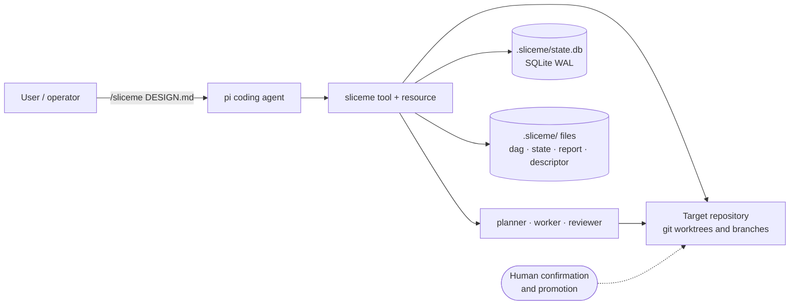
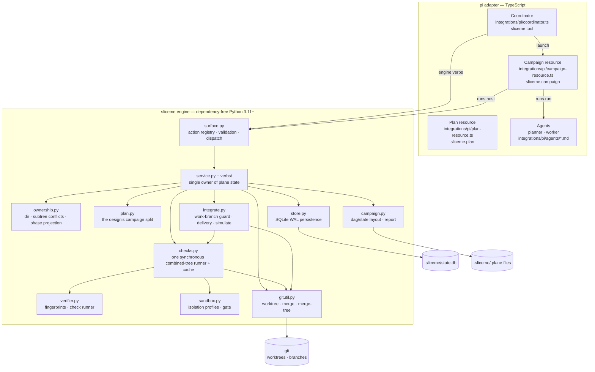
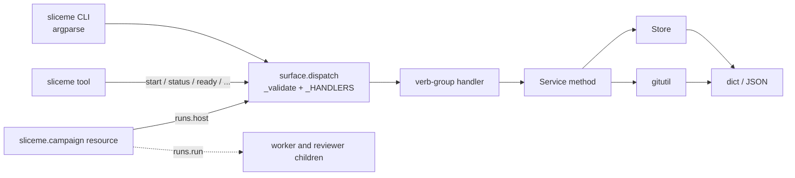
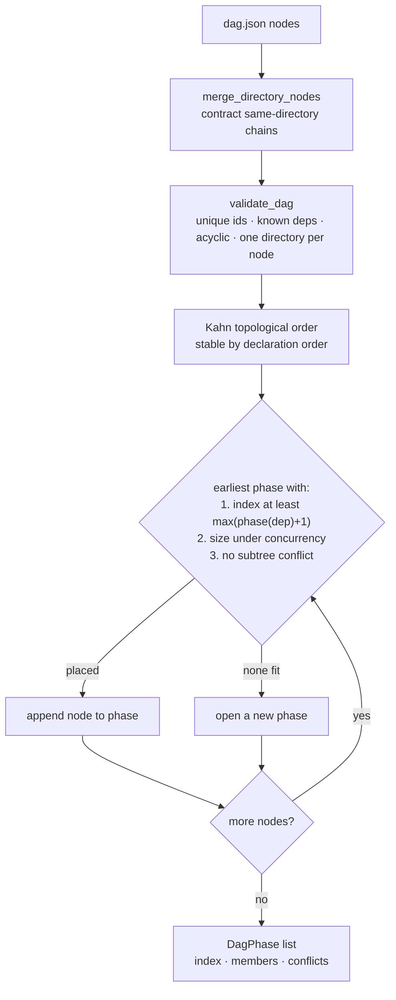
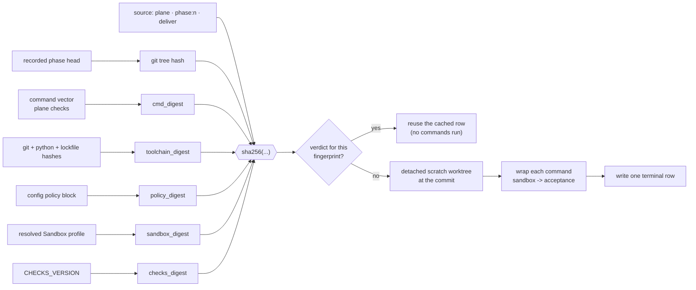
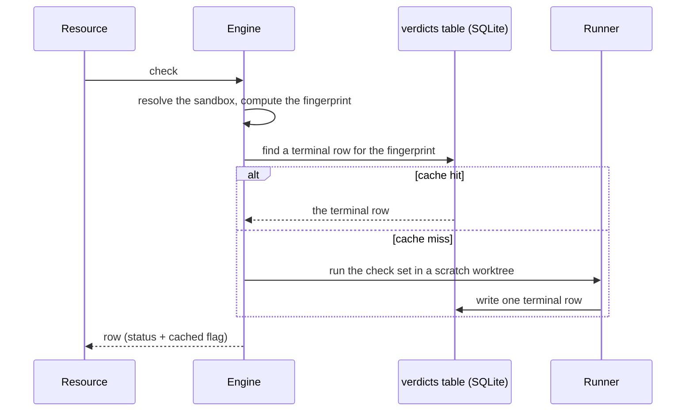
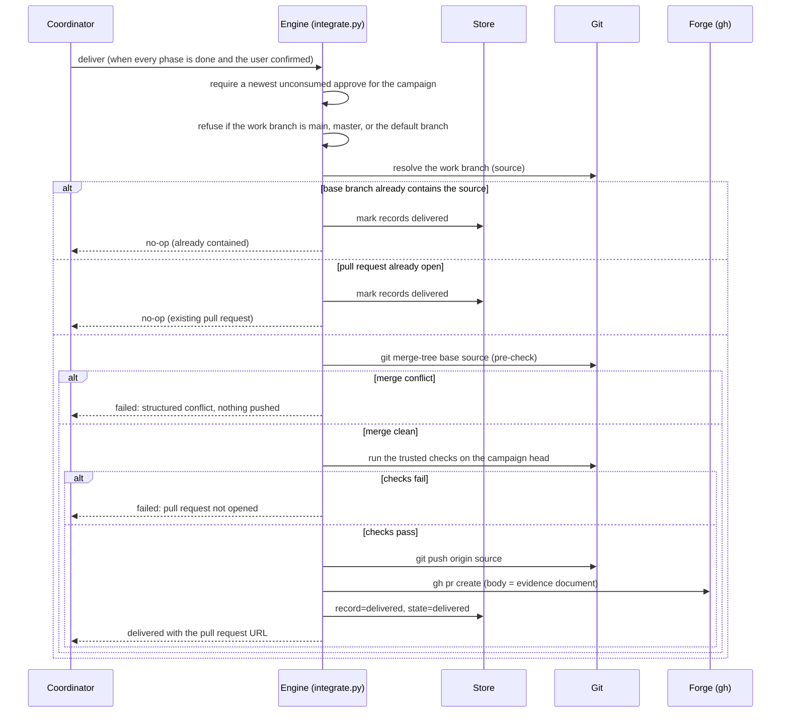
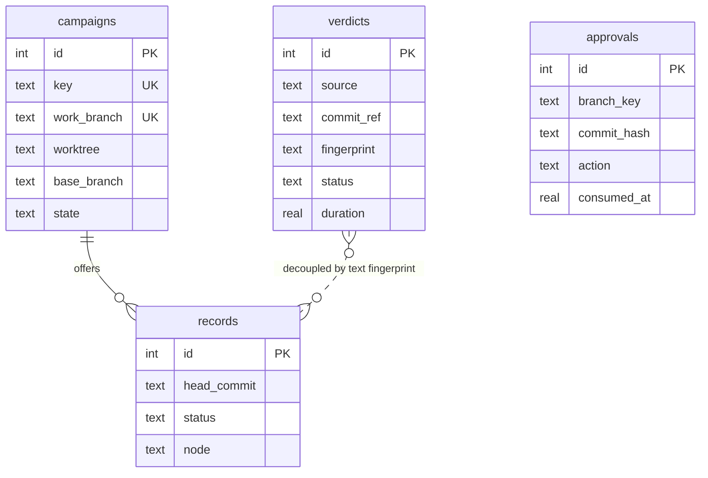
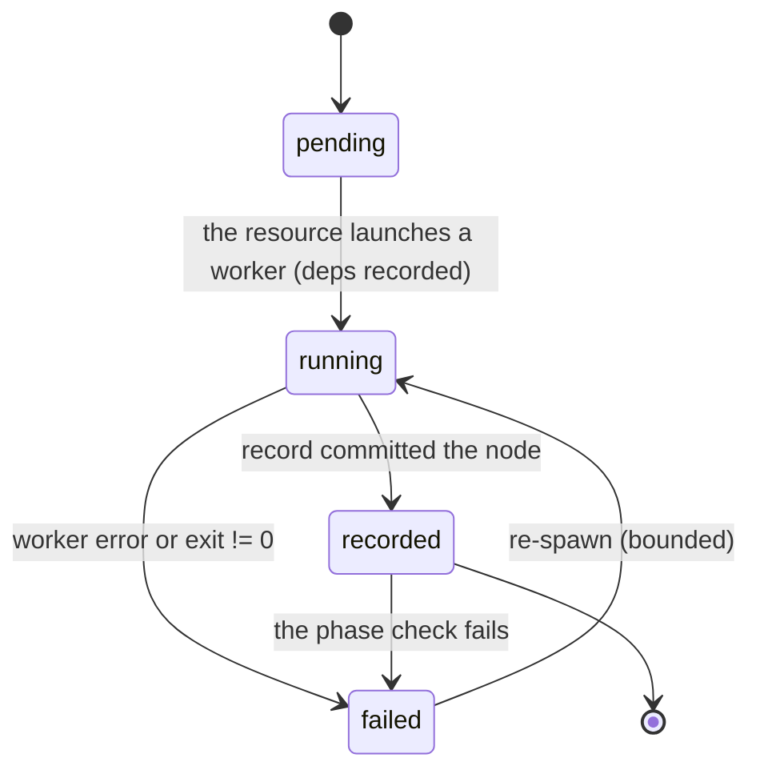

# Sliceme architecture

Status: directory-slice target. The engine change is tracked in
[directory-slices-plan.md](./directory-slices-plan.md). The GPU field is
removed.

This document describes the parts of Sliceme: the actors, the engine layers,
the campaign lifecycle, the phases, checks, delivery, and state. It is a map for
contributors and operators. The normative details live in these documents:

- [reference.md](./reference.md) — actions, modules, and state layout.
- [guide.md](./guide.md) — the model, ownership, and orchestration.
- [database.md](./database.md) — the SQLite schema and row lifecycle.
- [workflow.md](./workflow.md) — the campaign loop and the worker contract.

An interactive version of the part diagram with pan and zoom, focus, and
dark/light themes is at [architecture.html](./architecture.html). The source is
[architecture.diagram.json](./architecture.diagram.json).

## 1. In one paragraph

Sliceme turns a design document into a DAG of work. It packs non-conflicting
nodes into phases. It runs one pure-editor worker subagent per node in a single
campaign worktree. One synchronous check runner tests the recorded phase tree
against a content fingerprint. Sliceme then opens one pull request from the
work branch onto the default branch after the user confirms.

A pi coordinator session owns the planning and campaign loops. The trusted
`sliceme.plan` workflow resource runs the bounded planner re-pass loop. The
trusted `sliceme.campaign` workflow resource runs the work loop, and pi-subagents
owns child execution. A
dependency-free Python engine owns state, isolation, and delivery. The DAG
(`dag.json`) is the only authored schedule, and phases are a pure projection of
it.

## 2. Design principles and invariants

| Principle | Consequence in the code |
|---|---|
| **One engine, many adapters.** | `sliceme/surface.py` is the single action registry. `sliceme/cli.py` is generated from it; the pi tool forwards to the CLI. A packaging test asserts that the tool forwards the engine verbs. |
| **The engine owns state.** | `Service` is the only owner of plane state; adapters parse arguments and render results. The pi extension never writes the database or the DAG. |
| **The DAG is the only schedule.** | Phases are derived from `dir` + `depends_on` + `concurrency` by `ownership.plan_dag_phases`. |
| **Ownership is plan-time and directory-based.** | A node declares one directory (`dir`), and one directory has one node. Subtree overlap serializes nodes into different phases. `record` enforces this at run time (plan conformance). |
| **One check runner.** | All checks go through one synchronous runner, so shared resources stay serialized. |
| **Verification is pinned to content.** | A verdict is valid only for an exact `(tree, command vector, toolchain, policy, sandbox, checks, source)` fingerprint. |
| **Git and SQLite win over caches.** | Node statuses live in the adapter's session descriptor; git and `state.db` are authoritative. On conflict, git and `state.db` win. |
| **Fail closed, fail lastingly.** | A missing sandbox gate or a default-branch work branch aborts before mutation; a failed check or a forge failure leaves the campaign working. |
| **pi-subagents owns children.** | The resource requests children through `runs.run`; pi-subagents owns status, events, tool scoping, and control. |

## 3. System context

Who and what Sliceme talks to:



- **pi** is the only supported host today. The engine itself is host-agnostic:
  anything that can invoke the CLI gets the same behavior.
- The **target repository** is the product that Sliceme builds. Sliceme mutates
  it only through `git` operations (worktrees, commits, pushes, pull requests).
  Sliceme never commits its own plane files: it adds `.sliceme/` to the
  repository's `.git/info/exclude`.
- **Promotion to the default branch is a human act on the forge.** The engine
  refuses to push `main`, `master`, or the recorded default branch as the
  work branch, with no override. The pull request base is the base branch
  (`main`).

## 4. Layered part view



The direction of dependency is always **downward**: surface → service → domain
modules → persistence and git. No domain module imports an adapter, and no
adapter owns state.

### Module responsibilities

| Module | Responsibility |
|---|---|
| `sliceme/surface.py` | **Single source of truth**: the action registry, parameter validation, and dispatch. |
| `sliceme/cli.py` | Generated `argparse` CLI; human and `--json` output. |
| `sliceme/service.py` | The verb facade: composes the verb-group mixins and owns the bound campaign. |
| `sliceme/verbs/` | The verb groups: bootstrap, campaign, status, review, delivery, sessions. |
| `sliceme/store.py` | SQLite (WAL) persistence; additive migrations. |
| `sliceme/gitutil.py` | Git plumbing: worktree, merge, merge-tree, branch, head, push. |
| `sliceme/ownership.py` | Directory ownership, the DAG phase projection, and the same-directory merge. |
| `sliceme/plan.py` | The design's `sliceme-campaigns` split: parse and validate. |
| `sliceme/verifier.py` | Fingerprints and the sandboxed check runner. |
| `sliceme/sandbox.py` | Isolation profiles, project manifests, the gate, and command wrapping. |
| `sliceme/checks.py` | The single synchronous combined-tree runner and the `verdicts` cache. |
| `sliceme/integrate.py` | Work-branch guard and the base branch, pull request delivery, and combined-tree simulation. |
| `sliceme/pullrequest.py` | The `gh` forge client. |
| `sliceme/campaign.py` | `dag.json` layout and readers; the deterministic report and evidence document. |
| `sliceme/review/` | The reduced review surface: `packet.py`, `diff.py`. |
| `integrations/pi/*.ts` | pi adapter: the `sliceme` tool, the `sliceme.plan` and `sliceme.campaign` resources, and the invocation helpers. |
| `integrations/pi/agents/*.md` | Planner and worker prompts plus their `tools:` scoping. |

## 5. The action surface and the request path

The engine owns the actions in `surface.ACTIONS`. The `sliceme.plan` resource
runs the planner and validates the DAG. The `sliceme.campaign`
workflow resource adds the loop; it does not add engine actions.



| Action | Purpose |
|---|---|
| `start` (alias `init`) | Bootstrap the plane and a campaign for the current directory (idempotent). |
| `status` | The campaign state: records, phases, and checks; `short`, `unit`, `verbose`. |
| `sessions` | List the registered campaigns from their session descriptors. |
| `resume` | Reconcile a suspended campaign and return its resume plan. |
| `simulate` | Plan the phases and verify the combined tree. |
| `gc` | Prune worktrees, delivered branches, scratch, and finished campaign files. |
| `doctor` | Check git, `config.json`, and `state.db` health. |
| `ready` | The current-phase ready node ids, the phase index, and `paused`. |
| `plan` | The design's campaign split joined with the registry state. |
| `deliver` | Push the work branch and open the delivery pull request against the base branch after the confirmation. |
| `check` | The one combined-tree check runner for the current phase. |
| `open` | Create or reuse the single campaign worktree. |
| `record` | Record the current phase: conformance + per-node commits. |
| `approve` | Record one campaign approval. |
| `report` | Write the deterministic campaign report. |
| `evidence` | The deterministic evidence document (commits, checks, diffs, logs). |

To add an action: define it once in `surface.ACTIONS`, implement a handler in a
verb group and a `Service` method, and add the parameter forwarding in
`integrations/pi/coordinator.ts`. The CLI follows automatically.

A plane holds one `campaigns` registry and one or more campaigns. A campaign is
identified by its work branch. Every campaign-scoped action accepts
`--campaign REF`, where `REF` is a work branch, a branch key, or a writer
name.
A plane with one campaign makes the flag optional. A plane with several
campaigns returns a plane summary when the flag is absent.

## 6. The campaign lifecycle

```mermaid
sequenceDiagram
  autonumber
  actor U as User
  participant C as Coordinator
  participant R as sliceme.campaign
  participant P as Planner
  participant W as Worker (per node)
  participant X as Check runner
  participant V as Reviewer
  participant E as Engine (Service)
  participant G as Git

  U->>C: /sliceme DESIGN.md
  C->>E: start --design DESIGN.md (derive the branch; record main)
  C->>P: start (planner subagent)
  P->>P: writes the campaign dag.json
  C->>E: open (fetch main; worktree from origin/main)
  C->>R: launch the workflow (async)
  loop each ready node (dependencies done)
    R->>W: runs.run a worker per ready node (pure editor)
    W->>G: edit owned dirs only
    R->>E: record (per-node commits, conformance)
    R->>E: check (one combined-tree run)
    E->>X: run the checks in a scratch worktree
    R->>V: runs.run the builtin reviewer with the evidence
    V-->>R: findings
  end
  C->>E: evidence + report
  U->>C: confirm the pull request one time
  C->>E: approve
  C->>E: deliver (push the work branch; pull request against main)
```

The coordinator is **not** a worktree. `start` records the campaign without
creating one, so the coordinator's checkout holds no phantom worktree. The
resource owns the loop; it
reads engine state through `runs.host` and launches children through `runs.run`.
The workflow sandbox has no file access, so all state arrives as JSON from the
engine.

## 7. From DAG to phases

`dag.json` is canonical and is never committed. A phase is the largest set of
nodes that may run concurrently without conflicting on their directories. The
planner authors one node per directory; the engine then contracts any remaining
same-directory pair into one node.



| Rule | Definition |
|---|---|
| `phase(n)` | `max(phase(d) + 1 for d in depends_on)`, then the earliest phase with room under `concurrency` and no directory-subtree conflict. |
| `ready(n)` | `n` is a member of the current phase and is neither recorded nor running. The phase is the one scheduling gate; every dependency lives in an earlier phase. |
| `dir` conflict | Equal directories, or one an ancestor of the other. `src/api` overlaps `src` and `src/api/v2`. |

Every phase records onto the same campaign worktree. A later phase therefore sees
the files of the previous phase without a merge or a rebase. Sliceme defers the
pull request to the single `deliver` step. The engine projects the phases from
`dag.json` plus the recorded records in `state.db`; the adapter's session
descriptor carries the per-node status.

## 8. Checks: fingerprints and the runner

Sliceme pins every check to a fingerprint. A verdict is valid only for the exact
inputs that produced it.



Two paths share this primitive:

1. **Phase path (`check`).** The runner checks the recorded phase head
   with `source=phase:<n>`, and the reviewer judges the recorded evidence.
2. **Delivery path (`deliver`).** The plane's trusted checks run on the campaign
   head with `source=deliver` before the push. Sliceme reuses a passed
   fingerprint.

`source` is part of the identity, so a `phase:1` verdict can never collide with a
plane check. Sliceme folds in the sandbox digest and the checks version. A
stricter sandbox or a change in how checks run therefore invalidates cached
verdicts.

### The one runner



- One call runs one check set and writes one terminal row. There is no queue and
  no lease.
- `find_verdict` selects a terminal row for the fingerprint, so an unchanged check
  set never re-runs.
- A check command composes as `sandbox -> acceptance`. A stricter sandbox is a
  new fingerprint value.

## 9. Delivery



Delivery is deterministic and idempotent. Sliceme returns an open pull request as
it is. A base branch that already contains the work branch is a no-op.
Delivery pushes the work branch and opens one pull request with `gh`. The
engine never merges and never mutates the base branch. The work branch is
never the default branch.

## 10. State and persistence

Everything is reconstructable from `.sliceme/` plus git. The database holds what
git and files cannot express quickly; the DAG and the runtime cache are files.



### Plane file layout

```text
.sliceme/
  config.json                      # version, default_branch, checks, policy (campaign mirror kept one release)
  state.db                         # SQLite WAL: campaigns, records, verdicts, approvals
  workspace.lock                   # the one workspace lock (campaign create, record, delivery)
  active.<pid>.campaign            # per-process pointer to the session's campaign
  <branch-key>.dag.json            # canonical plan (never committed)
  <branch-key>.report.md           # deterministic report (kept on cleanup)
  <branch-key>.evidence.json       # complete evidence (full check output)
  <branch-key>.evidence.md         # human evidence; the pull request body
  <branch-key>.session.json        # adapter-written suspend/resume descriptor
  <branch-key>.control.json        # cooperative pause flag
  <branch-key>.worker_<id>.log     # one log per worker id
  worktrees/                       # the single campaign worktree
  scratch/                         # detached simulation and check worktrees (transient)
```

`<branch-key>` replaces `/` with `--` (`feat/x` → `feat--x`), so one campaign's
files form a single glob and campaigns cannot collide. The adapter's session
descriptor carries the per-node status; git and `state.db` win. A plane holds
one `campaigns` registry table and several
campaigns. The
suspend/resume descriptor is a file, not a table.

## 11. Concurrency, failure, and recovery



| Failure | Engine response |
|---|---|
| Worker produces no record / fails the checks | The coordinator retries, splits the node, or stops. |
| Reviewer reports a problem | The coordinator retries, splits the node, or stops. |
| A phase record touches a path outside every node's `dir` | Plan conformance rejects it; the coordinator corrects the `dir` or adds a `depends_on` edge; phases reproject. |
| Merge conflict at `deliver` | The `merge-tree` pre-check refuses delivery; structured findings return; nothing is pushed. |
| Checks fail at `deliver` | Sliceme does not open the pull request; records stay undelivered. |
| Default-branch work branch | Refused at `start` and at `deliver`; there is no override. |
| Orchestrator crash | The children of the coordinator die. On resume, a `running` node stays `running` if the campaign worktree is present, else `pending`; a `recorded` node stays `recorded`. Sliceme reuses the campaign worktree. |
| Concurrent spawns completing together | Coordinator state is a rebuildable cache; git and `state.db` are the source of truth. |

Bounding knobs: `concurrency` (phase size), `phaseCap` and `nodeCap` (the resource
loop), per-command timeouts, and one synchronous runner.

## 12. Package and extension layout

```text
sliceme/
  bin/sliceme                 # portable shim; runs the bundled CLI without installation
  sliceme/                    # dependency-free Python engine (see §4)
  integrations/pi/
    common.ts                 # runSliceme, campaign paths, the pi-subagents loader
    coordinator.ts            # `sliceme` tool, agents, commands, the suspend hooks
    campaign-resource.ts      # the trusted `sliceme.campaign` workflow resource
    agents/{planner,worker}.md
  docs/                       # guide, reference, workflow, database, architecture, ...
  tests/                      # unittest suite plus the Node resource harness
  package.json                # pi package manifest (extensions: coordinator.ts)
  pyproject.toml
```

The tool registers **inactive**; `/sliceme [DESIGN.md]` activates it for the
session. The extension registers the two agent definitions through the
pi-subagents runtime-agent registry, so each worker runs with its `tools:`
allowlist. This is the enforcement point for "workers own their node; only the
resource and the engine own the campaign".

## 13. Diagram index

| Diagram | Type | In this document |
|---|---|---|
| Component architecture (interactive) | architecture | [architecture.html](./architecture.html) |
| System context | flowchart | §3 |
| Layered components | flowchart | §4 |
| Request path / action surface | flowchart | §5 |
| Campaign lifecycle | sequence | §6 |
| DAG → phases | flowchart | §7 |
| Fingerprint and the check runner | flowchart | §8 |
| The one runner | sequence | §8 |
| Integration and delivery | sequence | §9 |
| Entity relationships | ER | §10 |
| Node state machine | state | §11 |

## 14. Related documents

- [guide.md](./guide.md) — the model, ownership, orchestration, and agent roles.
- [reference.md](./reference.md) — actions, modules, state layout, verification, tests.
- [workflow.md](./workflow.md) — the campaign loop and the worker contract.
- [database.md](./database.md) — the SQLite schema and row lifecycle.
- [observability.md](./observability.md) — status projections and check counts.
- [sessions.md](./sessions.md) — suspend and resume, checkpoints, and the campaign registry.
- [review.md](./review.md) — the confirmation gate, the report, and the evidence.
- [publishing.md](./publishing.md) — packaging and release.
