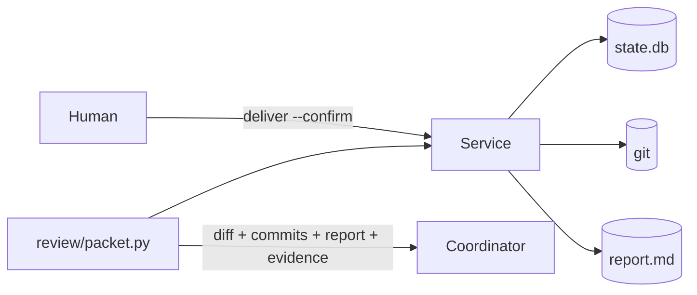

# Sliceme campaign review

Status: implemented. Commits accumulate while the campaign runs. A human
confirms the whole campaign commit set one time. Sliceme includes the report
even though git ignores it.

A human reviews the unmerged commits from the campaign worktree. The reviewer
reads the diff and the report, then confirms or declines the campaign. The
design has one safety goal: **no delivery without a human confirmation of the
campaign.** Delivery records the confirmation as one campaign-level approval.

## 1. Scope

In:

- One campaign-level approval for the whole commit set. `deliver` records it.
- Review of the accumulated campaign commits, at any time, before or after the
  last phase.
- The generated report (`.sliceme/<branch-key>.report.md`), even though it is
  git-ignored, shown as a virtual file next to the diff.
- The check evidence for each reviewed commit.
- A non-blocking review: workers never wait for the human, and the coordinator
  proceeds after a human confirms the campaign.
- Several campaigns in one plane, scoped by `--campaign`.

Out:

- A browser client, a review server, and its trust boundary.
- Comments, replies, and the comment lifecycle.
- Per-commit approval.
- Remote or shared review.
- Uncommitted working-tree changes. The review unit is commits.
- Promotion to a shared branch. After a `local` delivery the user pushes the
  base branch, and after a `pull_request` delivery the user merges on the
  forge. Both steps stay human acts.

## 2. Architecture



The `sliceme/review/` package keeps two modules:

| Module | Responsibility |
|---|---|
| `packet.py` | The snapshot: accumulated commits, the report, the evidence, and `campaign_branch_key`. |
| `diff.py` | Diff parsing and the file index. |

`Service` stays the only owner of state. The packet reads git and the report
file, so the review surface adds no second store.

## 3. Review model

- The review unit is the campaign worktree. Commits accumulate as phases land.
- A review packet is the diff from the base branch to the campaign head
  (`target_tip...source_tip`), the commit list, the report, and the check
  evidence. The diff base is the base branch, not the work branch: the
  work branch is the head.
- The packet reads the diff from git and the report from disk.
- The human confirms or declines the whole campaign commit set. A decline is
  simply no `deliver` call, so the engine stores no decline row.
- One approval is one row keyed by `(branch_key, commit_hash)` with a null
  `commit_hash`. `deliver` appends it and consumes it when the delivery lands.

The **report** is a virtual file. It is git-ignored, so it is not a commit. The
packet carries its path, its content, and its update time. The report is
evidence for the reviewer, never a merge gate.

The **evidence** is the newest check for each commit. The row holds the status,
the duration, the fingerprint, the command vector, and the output. Evidence is
the main reason to read the packet.

Review is **incremental and non-blocking**. A human can review after the first
commit and confirm as work lands. Workers keep editing; nothing waits on the
review. The coordinator delivers only after a human confirms the campaign.

## 4. State

One table in `.sliceme/state.db` follows the existing `CREATE TABLE IF NOT
EXISTS` pattern.

**`approvals`** — `branch_key`, `commit_hash`, `action`, `actor`,
`note`, `created_at`, `consumed_at`. Append-only. A campaign-level decision uses
a null `commit_hash`. `deliver` writes one `approve` row and consumes it when
the delivery lands. The table keeps the older rows, so the decision history
stays auditable.

`gc` prunes rows for campaigns whose branch and delivery are gone and older than
a retention window (`policy.review_retention_days`, default 30). It keeps every
key in the campaign registry, every descriptor file, and the current campaign,
so an active review never disappears.

## 5. The confirmation and delivery

Sliceme folds the approval into `deliver`. There is no separate approve step.

```bash
sliceme deliver --confirm [--actor A] [--note TEXT] [--mode MODE]
                 [--narrative TEXT]
```

- Without `--confirm`, `deliver` refuses with a `not_confirmed` finding.
  `--confirm` is the human confirmation token.
- With `--confirm`, `deliver` appends one campaign-level `approve` row, runs
  the delivery, and consumes the row when the delivery lands.
- A failed check or a failed forge call leaves the row unconsumed. The engine
  marks the row void (`action='void'` and `consumed_at`), so the next `deliver`
  call needs a new `--confirm` and appends a new row. The void row stays for
  audit evidence.

The coordinator prompts for confirmation one time, after the last phase. It
writes the evidence and the report. It shows the summary and the delivery
details to the user, then asks for one confirmation. The details are the
selected mode, the branches, and the title for a pull request. On a
confirmation it runs `deliver --confirm --narrative TEXT`; on a decline it
stops and keeps the campaign for a later try. The confirmation is the only
pause; suspension stays an explicit user command.

## 6. The report

```bash
sliceme report [--narrative TEXT] [--design REF] [--slow-seconds N]
```

`report` writes `.sliceme/<branch-key>.report.md`. The skeleton is
deterministic: the design reference, the work branch, the nodes, the
records, and the newest check per record. A node with a record shows
`recorded`, because the record is the durable evidence that the node
finished. A node with no record shows the session descriptor status, which
is the only place a suspended node's `running` status lives.
`--narrative` adds the coordinator's summary under the leading summary. The
report leads with the summary and the change rows. It then shows the
verification and the timing summary. The complete detail follows: the nodes,
the per-commit evidence, and the artifact paths.

The action also writes `.sliceme/<branch-key>.timings.md` and prints it in the
terminal. The timing report groups the thinking steps by agent, the tool calls
by tool name, and the longest commands by duration. A command at or above the
slow threshold (`--slow-seconds`, default 120) is shown in full. The engine
ingests the child transcripts at `record`, `check`, and `report`, so the report
covers the whole campaign.

### 6.1 The pull request body

The body of the delivery pull request is the summary document. The engine
writes it from the campaign state at delivery time:

- **Summary**: the deterministic digest (the design, the commit and node
  counts, and the whole-campaign diffstat) and the `--narrative` text.
- **What changed**: one row per campaign commit with the short hash, the
  owned directory, the commit subject, and the diffstat.
- **Verification**: one row per recorded check with the status, the duration,
  the fingerprint, the commands that ran, and the commit range the checked
  tree covers. A trailing list names the commits that no check covers.

The body carries no node goals, no task lists, no check output, no worker
logs, and no local paths. A reviewer reads the diff for that detail. The
complete record stays in `.sliceme/<branch-key>.evidence.md` and
`.sliceme/<branch-key>.evidence.json`.

The footer names the campaign branch and the delivery base.

## 7. Delivery

The coordinator triggers delivery after every phase completes and a human
confirms the campaign. The delivery mode is `pull_request` or `local`. The
design orders delivery to avoid a race with the campaign loop:

1. **Quiesce.** The resource records and checks one phase at a time, so no worker
   commits mid-delivery.
2. **Lock.** Take the one workspace lock at `.sliceme/workspace.lock`.
3. **Record the approval and re-check the gate** under the lock and immediately
   before the merge or the push.
4. Deliver in the selected mode: `pull_request` pushes the work branch and opens
   the pull request; `local` merges the work branch into the local base branch.
   Both modes mark the records delivered, set the campaign to `delivered` or
   `landed`, and consume the approval.

Preconditions, enforced in `Service` and `integrate`:

- the `confirm` token is present;
- the campaign branch is not the default branch, and it differs from the base
  branch;
- the campaign worktree has no uncommitted changes;
- the base branch worktree is clean;
- a `local` merge refuses when the remote base is ahead or has diverged;
- the merge-tree pre-check refuses delivery on a conflict;
- the trusted checks pass, unless you pass `--no-checks`.

## 8. Concurrency

- **Schema once.** Startup opens each plane's `Store` once to run `SCHEMA` and
  `_migrate`, then closes it.
- **Lock order.** The plane delivery lock, then the campaign lock, then SQLite
  row locks.

`deliver` and `report` join `ACTIONS`. The coordinator records the approval
inside `deliver`, and a human owns the `--confirm` decision.

## Related

- [guide.md](./guide.md) — the model, ownership, and orchestration.
- [architecture.md](./architecture.md) — layered parts and the campaign lifecycle.
- [reference.md](./reference.md) — actions, modules, state layout, and gaps.
- [database.md](./database.md) — the SQLite schema and row lifecycle.
- [workflow.md](./workflow.md) — the campaign loop and the worker contract.
- [sessions.md](./sessions.md) — suspend and resume.
